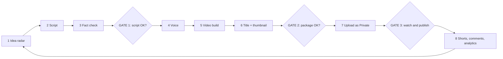

# YouTube Autopilot Playbook: Niches, Workflow and 10-Month Plan

Prepared 27 November 2026 for the Pitou AI team. Plan window: December 2026 to September 2027.

## 1. The answer first

Launch one flagship English channel in the niche **"AI tools and automation explained for small businesses"**, built on the six-step Claude pipeline from the second reel, with three human checkpoints instead of a full crew. Start a second channel only after Month 3, picking from niches #2 to #5 below based on what the first channel's data shows.

Why this one first: it is the only niche where every video is also a sales asset for Pitou AI. Even a small channel (a few thousand subscribers) can bring client enquiries, which earns money long before YouTube ad revenue starts. It also has some of the higher ad rates on YouTube, it stays searchable as long as new AI tools keep launching (which they will through 2027 and beyond), and the team already knows the subject, which is what YouTube's 2026 rules reward.

## 2. What the two reels actually show

**Reel 1 (TechDaily AI, sponsored by CorpDoc.ai):** "50 faceless video styles, no camera": 3D cartoon, Roblox, rubber hose, miniature diorama, paper puppet and more, then "comment LIST to get all 50 prompts in your DMs." These are **visual styles, not niches**. A style is the costume; a niche is the story the audience keeps coming back for. We will use 2 or 3 of these styles as our look (miniature diorama and paper puppet suit history and explainer content well). The "comment LIST" mechanic is a lead magnet built to grow their Instagram; treat its claims as marketing, not data.

**Reel 2 (Freelance IT Services):** a six-step chain where Claude runs a channel:

| Step | What the reel uses | Real tool behind it |
|---|---|---|
| 1. Idea | Claude reads top videos in your niche and finds the pattern | YouTube search + Claude analysis |
| 2. Script | Free skill pack, 11 skills, 21 hook formulas, hook scoring | Jakeschincariol/youtube-agent-skill on GitHub (MIT) |
| 3. Voice | Free open-source voice model | Qwen3-TTS (Apache-2.0) |
| 4. Video | Claude Code writes each scene as a web page and renders it frame by frame to MP4. No editor, no timeline | HTML + JS render script + Python audio mix |
| 5. Title + thumbnail | Checked as a pair before posting ("fits on a phone") | A skill that checks the package |
| 6. Upload | Free YouTube uploader (MCP) | YouTube Data API v3 via an MCP server |

The reel itself admits two catches, and both are true: the Google Cloud setup takes about an hour, and uploads from an unverified Google app land as **Private** (with a default limit of about 100 uploads per day), so a human still presses Publish. We keep that catch on purpose. It is our final quality gate.

What the reel leaves out, and what this plan fixes: no fact-checking step, no originality step (which is exactly what YouTube demonetizes in 2026), and no feedback loop from analytics back into ideas.

## 3. The rules of the game in 2026 (read this before anything else)

**AI is allowed. Mass-produced sameness is not.** In July 2025 YouTube renamed its "repetitious content" rule to "inauthentic content," and in July 2026 it clarified what gets demonetized: AI content made from generic templates that gives the impression of mass production without the creator's own insight. In January 2026 it terminated 16 channels with 35 million combined subscribers under this policy. So the channels that die are the ones that copy the "50 styles" reel literally. The ones that survive add something real: our own examples, our own opinions, our own footage.

**AI labels.** Since May 2026, realistic AI content gets a visible label below the player (or on top of a Short), YouTube also detects it automatically, and repeatedly hiding it can cost YPP membership. Animated or clearly unrealistic content does not need the label. YouTube says the label alone does not reduce reach or revenue. Our rule: tick the disclosure box whenever a realistic AI person, place or event appears.

**Kids content is a trap for us.** AI cartoon channels for children get big views, but "Made for Kids" videos earn much lower ad rates (contextual ads only), and there is active public pressure to ban AI content from YouTube Kids. Not a foundation for a 10-month business.

**Monetization thresholds (YouTube Partner Program):** 1,000 subscribers plus 4,000 public watch hours in 12 months, or 1,000 subscribers plus 10 million Shorts views in 90 days. A lower tier (around 500 subscribers) unlocks fan funding features. Confirm the current numbers in YouTube Studio when we apply.

## 4. Top 5 niches, ranked

Scores are out of 5. "Lasts to 2028" means people will still search for it in one to two years. "Automation fit" means how much of it the pipeline can make without a person. "Our edge" means what Pitou has that a random faceless channel does not.

| # | Niche | Lasts to 2028 | Ad value | Automation fit | Policy risk (5 = safest) | Our edge | Total |
|---|---|---|---|---|---|---|---|
| 1 | AI tools and automation for small business | 5 | 4 | 5 | 4 | 5 | **23** |
| 2 | Money basics for emerging markets (Southeast Asia lens) | 5 | 5 | 4 | 3 | 4 | **21** |
| 3 | Lost empires and ancient mysteries (Angkor and Asia first) | 5 | 3 | 4 | 4 | 5 | **21** |
| 4 | Southeast Asian food stories and how it is made | 4 | 3 | 3 | 5 | 5 | **20** |
| 5 | Psychology and human behaviour, animated | 5 | 3 | 5 | 3 | 2 | **18** |

Ad value is directional only. The RPM ranges in 2026 guides (for example personal finance at roughly $10 to $35 per 1,000 views, horror at $4 to $8) come mostly from tool vendors, conflict with each other, and are **unconfirmed**. We will use our own numbers from Month 4 onward.

### Explained like you are ten

**#1 AI tools for small business.** Imagine every month a new magic toolbox arrives at every shop in the world, but nobody reads the instructions. We make the instruction videos. Toolboxes keep arriving, so people keep needing new videos. And the shop owners who watch might hire Pitou AI to set the tools up for them. That is two prizes from one video.

**#2 Money basics for emerging markets.** Everyone has to handle money, but most money videos are made for Americans. People in Cambodia, Vietnam, the Philippines or Nigeria have different banks, apps and problems (cash, dollars and local currency, sending money home). We explain money for them. Advertisers pay a lot to appear next to money videos. The catch: we must never promise people they will get rich, and we must check every fact twice. We already have a starting script in this repo: `5-rules-to-win-with-money.md`.

**#3 Lost empires and mysteries.** People love a good story about a giant city in the jungle, a king, a puzzle nobody solved. Those stories never go out of date: a video about Angkor made today is still good in five years. We live next to one of the greatest ancient cities on Earth, so we can film real footage nobody else has, which makes our videos look real and trustworthy, not like copied AI. The diorama and paper-puppet styles from Reel 1 fit here perfectly.

**#4 Food stories.** Everybody eats, and watching how food is made is relaxing and fun. Cooking videos without a face are one of the fast-growing types on YouTube. Pitou Foods gives us real kitchens, real ingredients and real people to film, so it is hard for anyone to copy. It needs more filming, so it is less automatic, which is why it is #4 and not higher.

**#5 Psychology explained.** Why do we procrastinate? Why do we believe rumours? Everyone wonders about their own brain, forever. These videos are easy to make with animation. But many channels already do this, and we have no special advantage, so it ranks last.

### Niches we looked at and rejected

AI kids cartoons (low pay, high scrutiny), horror stories (high views but low pay and saturated with AI copies), "make money online" and "0 to 10K subs" style content (crowded, and full of earnings claims we cannot verify), and Roblox or game-character content (uses other companies' characters and is a copyright risk).

## 5. The channel: positioning and formats

**Working concept:** AI tools explained plainly, for people who run a shop, a restaurant, a clinic or a small agency. Name to be decided; check that the name and handle are free on YouTube, Instagram and TikTok and that it does not resemble any existing brand. Suggested candidates: "Plain AI," "AI at Work, Simply," "The Small Shop AI."

**Formats (in this order of priority):**

| Format | Length | Frequency | Purpose |
|---|---|---|---|
| "Do this with AI" tutorial | 8 to 12 min | 1 per week | Search traffic, watch hours, Pitou AI leads |
| Tool face-off ("X vs Y for a small shop") | 8 to 12 min | Every 2 weeks | High-intent search, affiliate potential |
| Real case walkthrough (anonymized client workflow) | 10 to 15 min | Monthly from Month 3 | Trust, the strongest originality signal |
| Shorts cut from the long videos | 30 to 60 s | 5 per week | Discovery and subscribers |

Every long video must contain at least one thing only we can provide: a screen recording of us actually doing the task, a real result, or a clear opinion. That is our insurance against the inauthentic-content rule.

**Client names:** never show a client's name, logo, data or screens without written permission. Default to anonymized walkthroughs.

## 6. The workflow: eight stations, three human checkpoints

Think of it as a factory line. Machines do the heavy lifting at every station; a human only stands at the three gates marked GATE.

### Station by station

**1. Idea radar (automatic, weekly).** Every Monday, Claude pulls the top recent videos for 15 to 20 seed searches (YouTube Data API search, about 100 calls per day free), plus YouTube Studio's Inspiration tab and Google Trends, and writes an "idea board" of 10 ranked ideas: what the winners share, the gap nobody has covered, the search phrase to target. Output lands in a Notion database or Google Sheet.

**2. Script (automatic).** Claude, loaded with a YouTube skill pack (Jakeschincariol/youtube-agent-skill or agricidaniel/claude-youtube; review their code before installing), writes 5 hook options from the hook formulas, scores them, then writes the full script with retention beats marked. We add a Pitou "house style" file: plain words, one idea per sentence, at least one real demo per video, no hype, no earnings promises.

**3. Fact check (automatic, second model).** A different model checks the script so one AI does not mark its own homework. Gemini with Google Search grounding, or ChatGPT with web search, receives the script and returns every factual claim with a source or a "cannot verify" flag. Anything unverified is cut or rewritten.

**GATE 1 (human, 10 minutes).** The Producer reads the script and the fact-check report, approves or sends back with one line of notes.

**4. Voice (automatic).** Two options. Budget: Qwen3-TTS, free and open-source, as in the reel. Quality and trust: a paid voice service such as ElevenLabs, ideally with one consistent cloned voice of a real team member who consents in writing, so the channel has a recognisable human voice. We recommend the second for the flagship; it is the single biggest "trust" upgrade. Pricing is unconfirmed; check current plans before committing.

**5. Video build (automatic, with one human recording).** Claude Code builds motion graphics as code, scene by scene, renders to MP4 with headless Chromium and ffmpeg, and mixes voice and music with a Python script, exactly as the reel shows. Mixed in: our own screen recordings of the tool being used (the Producer records these, 20 to 30 minutes per video; this is the originality ingredient), and stock or AI B-roll where needed (Higgsfield, Veo, Kling or similar; label anything realistic).

**6. Title and thumbnail (automatic).** Claude writes 10 titles and 3 thumbnail concepts as a pair (the reel's "fits on a phone" check), makes the thumbnails in Canva from a fixed brand template, and writes the description, chapters and tags.

**GATE 2 (human, 10 minutes).** The Producer picks the title and thumbnail and loads the two best thumbnails into YouTube's built-in Test and Compare.

**7. Upload (automatic).** The YouTube uploader MCP sends the video, captions, chapters and thumbnail to the channel as **Private**, ticking the AI disclosure box when needed.

**GATE 3 (human, 15 minutes).** The Producer watches the whole video at 1.5x speed on a phone, checks sound, spelling, facts and the disclosure setting, then schedules it public. Nothing goes public without a human having watched it.

**8. After publishing (automatic).** Claude cuts 3 to 5 Shorts from each long video, drafts replies to comments for a human to approve in one batch, and every Friday writes a one-page report from YouTube Analytics: what got clicks (CTR), what kept people watching (retention), what brought subscribers, and which Pitou AI enquiries came in. That report feeds the next Monday's idea radar. The loop closes.

### Who does what

| Role | Who | Time per week | Owns |
|---|---|---|---|
| Founder | You | 1 hour | Monthly direction, Friday report review, final say on niche #2 |
| Producer (channel operator) | 1 team member | 15 to 20 hours | Gates 1 to 3, screen recordings, comment approvals, keeps the pipeline running |
| Builder (part-time, first 6 weeks only) | 1 technical team member | 10 hours | Installs and maintains the pipeline, Google Cloud setup, fixes breakages |
| AI crew | Claude (main), Gemini or ChatGPT (fact check), voice and image tools | Unlimited | Everything else |

About 1.5 people in total once the pipeline is built. That is the "less stressful" part: humans only decide and check; they do not edit timelines.

## 7. Ten-month plan (December 2026 to September 2027)

| Month | Phase | What gets done | Target by end of month |
|---|---|---|---|
| 0: Dec 2026 | Build | Pick name and brand; create channel and Google Cloud project; install skill packs, voice, render pipeline and uploader MCP; write house style file; make 3 pilot videos that never go public | Pipeline makes one full video end to end |
| 1: Jan 2027 | Launch | Publish 1 long + 5 Shorts per week; first 4 tutorials target the most-searched small business AI tasks | 8 long videos live; first Friday reports running |
| 2: Feb 2027 | Learn | Keep cadence; rewrite titles and thumbnails on any video under 4% CTR; add tool face-off format | Clear view of which topics get clicks |
| 3: Mar 2027 | Decide | **Review meeting:** keep, adjust or switch the flagship angle. Pick niche #2 for a second channel from the data. Add monthly case walkthrough | Go or adjust decision documented |
| 4: Apr 2027 | Scale | Raise to 2 long videos per week if quality holds; clone pipeline for channel #2 (likely Lost Empires or Money Basics) | Channel #2 pilot videos ready |
| 5: May 2027 | Second channel | Launch channel #2 at 1 long + 5 Shorts per week; flagship continues | Both channels on schedule |
| 6: Jun 2027 | Monetize | Apply for YPP when eligible; add a lead form link (Pitou AI free audit) to every flagship description; add affiliate links only for tools we actually use | First tracked Pitou AI enquiries from YouTube |
| 7: Jul 2027 | Optimize | Double down on the top 20% of topics; build a playlist "series" around the best one (serialized formats are growing in 2026) | Retention and CTR trending up month on month |
| 8: Aug 2027 | Repurpose | Push Shorts to TikTok and Instagram Reels; consider a Khmer-language version of the best performers if Khmer voice quality is good enough (unconfirmed, needs testing) | Three platforms fed from one pipeline |
| 9: Sep 2027 | Review | Full 9-month review: revenue sources, cost per video, hours per video; decide on channel #3 or deeper investment | Written review and plan for the next 12 months |

We are not setting subscriber or income targets for these months, because any number we wrote would be a guess. The real targets are the process ones above, plus three numbers we watch weekly from Month 2: click-through rate (aim to beat 4%), average view percentage on long videos (aim to beat 40%), and subscribers per 1,000 views.

## 8. Tool stack and costs

| Job | Free option | Paid upgrade |
|---|---|---|
| Brain (ideas, scripts, code, video build) | None practical | Claude subscription with Claude Code |
| Fact check | Gemini free tier with search | Gemini or ChatGPT paid plan |
| Voice | Qwen3-TTS (open-source) | ElevenLabs or similar |
| Video render | Headless Chromium + ffmpeg (free) | None needed |
| B-roll and AI visuals | Stock footage libraries | Higgsfield, Veo, Kling or similar |
| Thumbnails | Canva free | Canva Pro |
| Upload | YouTube uploader MCP + YouTube Data API (free quota) | None needed |
| Idea and analytics data | YouTube Data and Analytics APIs (free) | vidIQ or TubeBuddy |
| Tracking board | Google Sheets or Notion free | None needed |

All paid prices are **unconfirmed** and change often. The Builder should price the stack in December before we commit.

## 9. Risks and how we handle them

| Risk | What we do |
|---|---|
| Demonetized for "inauthentic content" | Real screen recordings and opinions in every video; no template copy-paste between videos; human watches every video |
| AI gets a fact wrong | Second-model fact check plus Gate 1; cut anything unverifiable |
| Uploads stuck as Private | Accepted on purpose; Gate 3 publishes manually. Apply for the Google audit only if volume ever needs it |
| Skill packs or MCP servers from GitHub contain bad code | Builder reads the code before installing; run in a separate Google account and project |
| Unverified earnings claims in our own videos | House style bans them; every number needs a source |
| Client names or data shown without permission | Anonymize by default; written permission for any named case |
| Pitou Foods content (if niche #4 is chosen) | Never state or imply Halal certification in scripts, titles or on screen |
| Team burnout | Three gates only, fixed weekly rhythm, cadence goes up only when quality holds |

## 10. Things only you can provide (no rush, needed by mid-December)

1. A Google account to own the channel (ideally a new brand account, not your personal one).
2. Which team member is Producer and which is Builder.
3. Budget ceiling per month for paid tools.
4. Whether a team member is willing to have their voice cloned for the channel (written consent).
5. Final channel name choice from the candidates, or your own.

## Sources

YouTube inauthentic content policy and 2026 clarification: [TechCrunch](https://techcrunch.com/2026/07/20/youtube-clarifies-policies-around-ai-slop-and-upsetting-videos/), [Tubefilter](https://www.tubefilter.com/2026/07/13/youtube-inauthentic-content-monetization-policy-update/), [YouTube Help](https://support.google.com/youtube/answer/1311392), [vidIQ](https://vidiq.com/blog/post/youtube-ai-monetization/), [The Next Web](https://thenextweb.com/news/youtube-ai-slop-crackdown-faceless-creators-collateral-damage). AI labels: [YouTube Blog](https://blog.youtube/news-and-events/improving-ai-labels-viewers-creators/), [YouTube Help](https://support.google.com/youtube/answer/14328491), [9to5Google](https://9to5google.com/2026/05/27/youtube-updating-ai-content-labels/). Niches and RPM (vendor estimates, unconfirmed): [Fluxnote](https://fluxnote.io/blog/faceless-youtube-niches-that-pay-2026), [Opus](https://www.opus.pro/blog/faceless-youtube-niches-2026), [Vexub](https://vexub.com/blog/top-10-highest-rpm-youtube-niches). Kids content: [Tech Times](https://www.techtimes.com/articles/320340/20260713/ai-kids-cartoon-gold-rush-has-hidden-tax-coppa-cuts-revenue-80.htm), [The Star / NYT](https://www.thestar.com.my/tech/tech-news/2026/03/11/how-ai-generated-videos-are-distorting-your-childs-youtube-feed). Trends: [Epidemic Sound](https://www.epidemicsound.com/blog/youtube-trends-2026/), [Metricool](https://metricool.com/youtube-trends/), [Google Business](https://business.google.com/aunz/think/search-and-video/top-performing-youtube-genres-and-ads/). Pipeline tools: [youtube-agent-skill on SkillsMP](https://skillsmp.com/creators/jakeschincariol/youtube-agent-skill), [claude-youtube](https://cdn.jsdelivr.net/gh/AgriciDaniel/claude-youtube@main/README.md), [mcp-youtube-uploader](https://app.unpkg.com/mcp-youtube-uploader@1.3.0/files/README.md), [YouTube API quota](https://developers.google.com/youtube/v3/guides/quota_and_compliance_audits). Cambodia channel data: [Social Blade](https://socialblade.com/youtube/lists/top/50/subscribers/all/KH), [vidIQ Khmer Narrated Stories](https://vidiq.com/youtube-stats/channel/@khmernarratedstories/).
